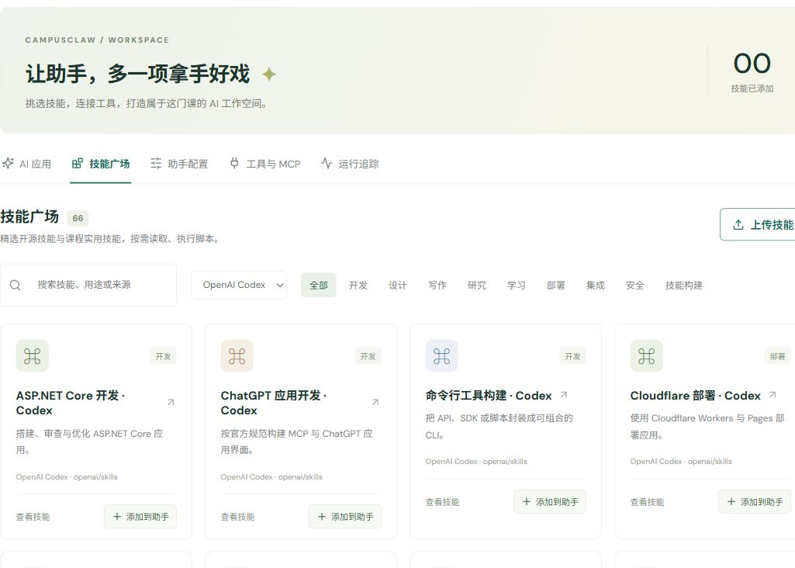

# 502 修复与 OpenAI Codex 技能库复验

日期：2026-10-21。此记录补充首轮阶段验收，当前公共技能总数为 66。

## 502 根因与修复

日志显示 Nginx 仍请求已失效的旧后端地址（`connect() failed (113: Host is unreachable)`），而后端进程正常。这与账号密码无关；在上轮单独更新后端后，其容器地址发生了变化，原来的静态上游解析没有更新。

修复：

- Nginx 使用 Docker DNS `127.0.0.11`，缓存 5 秒；共享上游区配合 `server backend:8000 resolve`。
- 后端增加健康检查；前端等待后端健康后启动。
- 所有反向代理路径保留原始 URI；API 禁用缓冲，允许 SSE 持续输出。
- 暂时 502/5xx/网络错误不清除刷新凭据；400/401 才判定登录失效。页面错误提示改为可理解的恢复提示。

实际回归：保留前端容器，重建后端，并用临时容器占住原地址，强制后端从 `172.18.0.6` 换为 `172.18.0.8`。前端没有重启，`/health/` 恢复 200，未登录 API 正常返回 401。之后通过前端代理实际登录教师、学生两个账号，均为 HTTP 200，课程角色保持 teacher/student。教师账号还完成浏览器界面登录。

证据：[502-regression.json](502-regression.json)。记录只使用账号类别，不含邮箱、密码或令牌。

## Codex 官方技能库

来源：[openai/skills](https://github.com/openai/skills)，固定提交 `49f948faa9258a0c61caceaf225e179651397431`。导入 curated 与 system 目录去重后的全部 43 项技能；重复名称 openai-docs 保留一份。原文指令与原始资源不改写，中文标题、分类和依赖说明属于平台展示元数据。

按 [OpenAI 官方技能文档](https://learn.chatgpt.com/docs/build-skills) 的渐进披露方式，初始上下文只包含绑定技能摘要，使用时读取完整 SKILL.md，再按需读取参考文件。原始 `agents/openai.yaml`、模板与图片均保留；公共列表和详情不返回图片的 Base64 字节，执行时才将资产提供给隔离环境。

运行环境补充 Poppler、reportlab、pdfplumber、PyYAML、nbformat、Git、ripgrep 与 curl；脚本仍默认无网络、无宿主目录挂载。需要 GitHub/Figma/Notion/Linear 等外部授权、Windows 桌面或 Codex 原生持久会话的技能，在详情中显示真实边界，导入不代表自动获得其外部依赖。

## 真实脚本验收

在独立演示课程绑定 `codex-jupyter-notebook`，真实模型执行：

1. `read_skill` 获取原始指令及平台适配说明。
2. `read_skill_resource` 读取原版 `scripts/new_notebook.py`。
3. `run_skill_script` 调用原版脚本，输入 `--kind tutorial --title MCP工具调用实验 --out outputs/mcp-tutorial.ipynb`。
4. 退出码 0，成功保存 Notebook v4，含 7 个单元格。它是生成的教程模板，未声称单元格已经运行。

完整请求与返回：[codex-acceptance.json](codex-acceptance.json)。生成产物：[mcp-tutorial.ipynb](mcp-tutorial.ipynb)。

## 检查结果

- 后端 28 项测试通过；包含 Codex 名称隔离、固定来源版本、二进制资源不泄露、按需加载与私人绑定。
- 前端 20 项测试通过；新增 502 保留凭据、恢复后刷新与认证失效清理检查。
- TypeScript、生产构建与 Nginx 配置检查通过。
- 教师界面「OpenAI Codex」来源筛选显示 43 张卡片。

