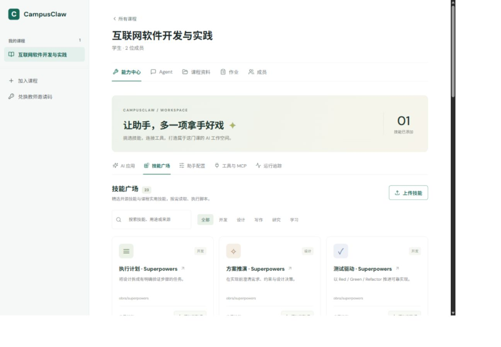
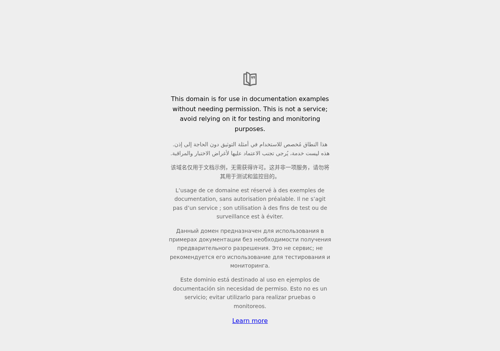

# 2026-10-21 实际验证记录

运行方式：本机 Docker Compose、PostgreSQL + pgvector；真实模型 `course-chat`，OpenAI 兼容接口；真实 embedding 服务。本文件使用独立演示课程数据。完整参数、模型原始 SSE 帧与返回内容在 [evidence.json](evidence.json)。

## 实际模型与工具链

| 检查 | Run ID | 模型请求轮数 | 工具结果 | 运行状态 |
| --- | --- | --- | --- | --- |
| 01 模板与普通问答 | 29 | 1 | 无工具调用 | completed |
| 02 技能与脚本执行 | 30 | 4 | read_skill=ok, read_skill_resource=ok, run_skill_script=ok | completed |
| 03 MCP 公式提示 | 31 | 2 | mcp_1_formula_hint=ok | completed |
| 04 MCP Python 与命令行 | 32 | 2 | mcp_1_python_execute=ok, mcp_1_shell_execute=ok | completed |
| 05 真实浏览器 | 35 | 2 | mcp_1_browser_open=ok | completed |
| 06 知识库检索 | 34 | 1 | 无工具调用 | completed |
| 07 上传技能与文件产物 | 37 | 4 | read_skill=ok, read_skill_resource=ok, run_skill_script=ok | completed |

数据分析结果：12、18、24、30 的均值和中位数均为 21。Python 整数求和返回 5050；Shell/Node 阶乘返回 720。浏览器成功获取 Example Domain 标题、正文、链接及截图。上传 ZIP 后脚本生成 summary.json，内容为 count=4、mean=21、median=21。

知识库测试返回课程验收说明切片；请求 trace 中可见对应片段，未发送整库。模板出现在 system，技能初始只传摘要，完整内容通过 read_skill 的 tool result 进入后续请求。MCP 请求中仅包含候选工具的名称、说明及 inputSchema；没有认证请求头或令牌。

## 自动检查

- 后端：26 项通过，包含课程流程、HTML 产物、权限、上传路径校验、账号隔离、公共 MCP 绑定、惰性技能加载、模板展开、RAG 片段、工具局部失败、非法 JSON 和调用上限。
- 前端：17 项通过；TypeScript 与生产构建通过。
- 数据迁移：makemigrations --check --dry-run，No changes detected。
- 隔离执行：[sandbox-checks.json](sandbox-checks.json) 中 Python/JavaScript/Shell 均真实执行；根目录不可写、普通脚本无网络（connect_ex=101）；输出文件成功导出。
- 提交前扫描实际环境中的模型、嵌入和邮件密钥：代码与验收资料无命中。

## 界面与用户账号

使用用户指定的现有账号正常登录；课程角色仍为学生。为其课程助手添加数据分析技能，并绑定公共 Python、Shell、浏览器工具。新建一条验收对话，真实执行 read_skill → run_skill_script，返回均值和中位数 21，工具标记显示成功。既有课程资料与旧对话保留。

检查桌面与窄屏布局；桌面页面未出现横向溢出。以下截图不包含账号密码。

## 边界

MCP 支持 Streamable HTTP（JSON 与 SSE），可分页发现、握手、使用会话标识并携带服务端认证；尚未接入 stdio 传输。本地官方 SDK 服务为无状态 HTTP 实现。浏览器使用无登录的临时上下文，只访问公网 HTTP(S)，当前工具提供打开、提取和截图。脚本在临时环境中运行，不会获得本机任意目录或用户登录态。上游技能依赖特定编辑器、插件、Git 仓库或外部服务时仍需要对应环境；平台不把未执行的步骤标记为已完成。

跨账号的接口隔离由自动测试覆盖；课件要求的「同伴使用其账号现场交叉验证」仍应在课堂由同伴执行，不能把自动化记录冒充同伴确认。
